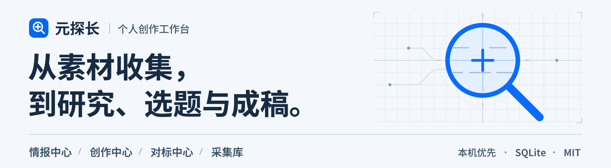
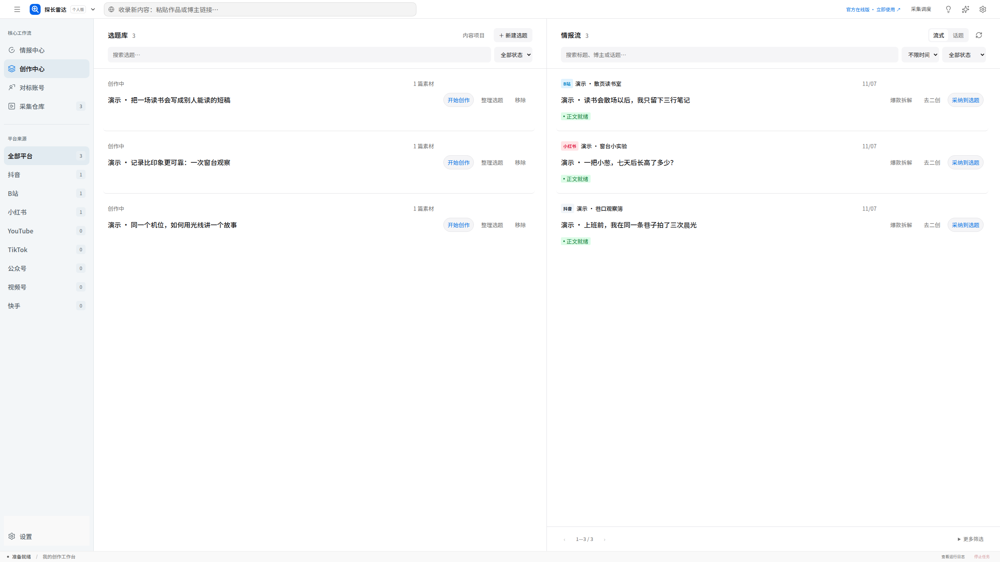
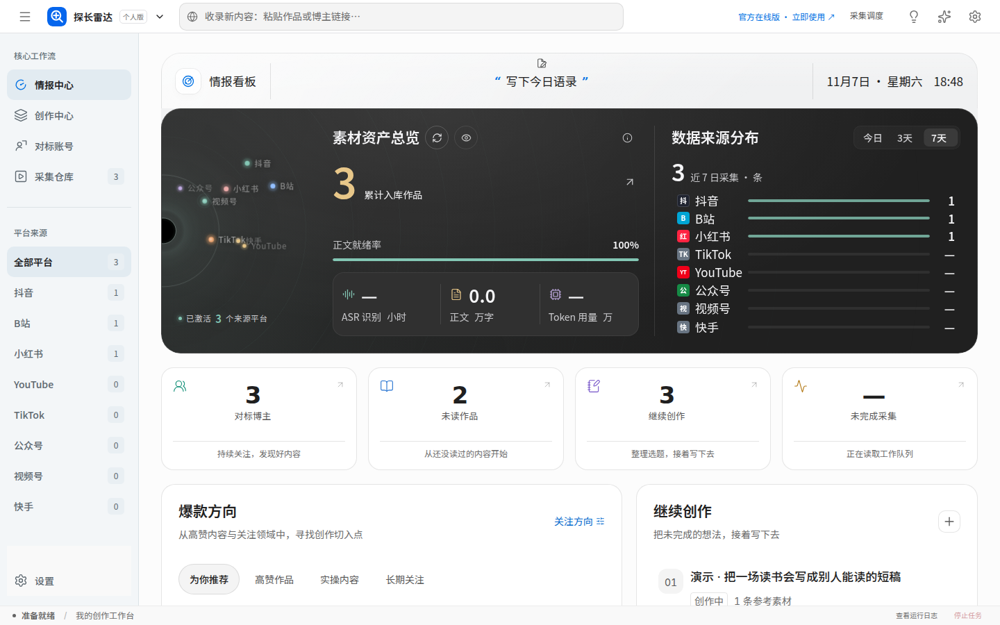
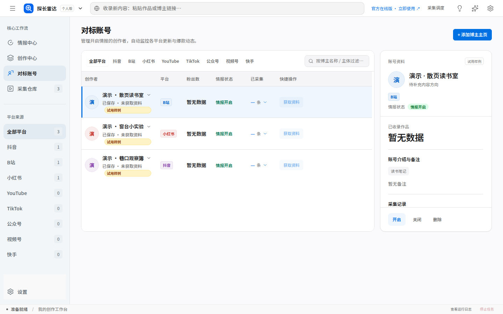
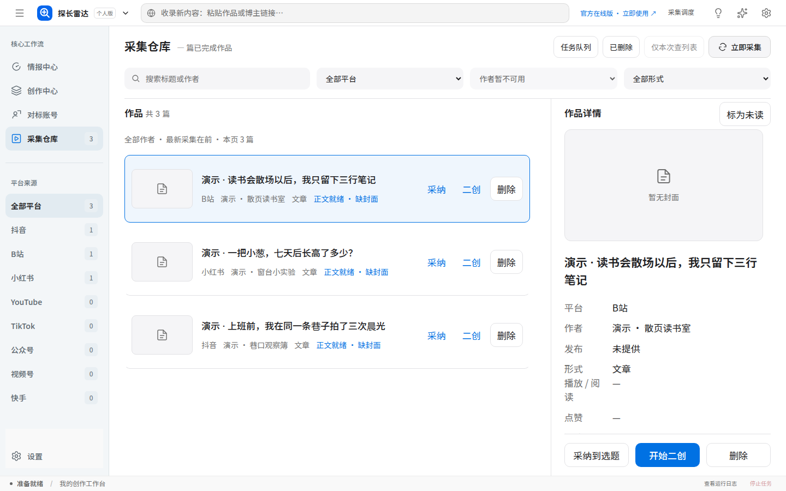
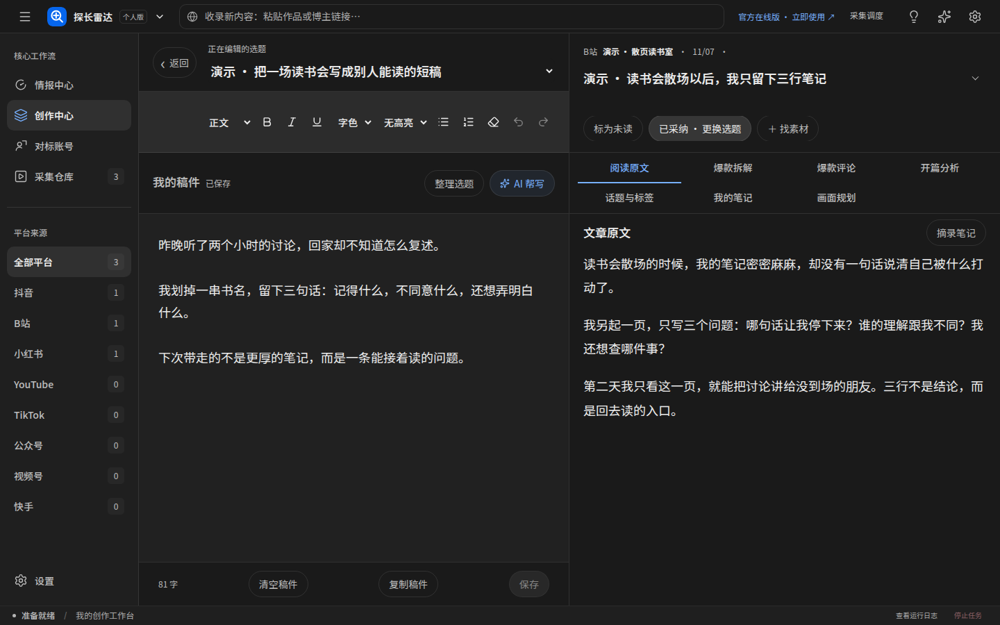
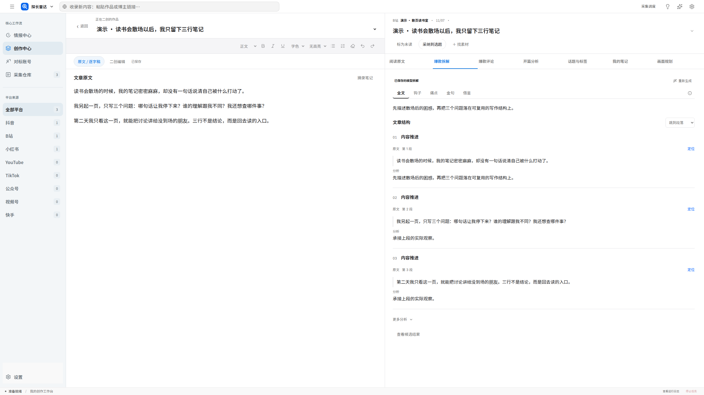
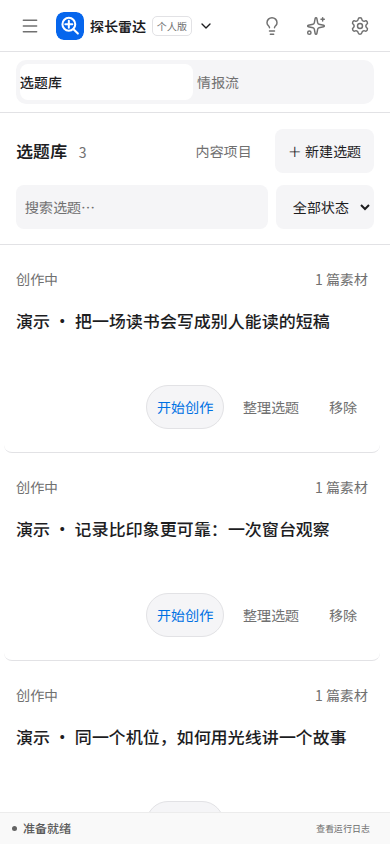

<p align="center">
  
</p>

<p align="center">
  <a href="https://github.com/wyghxy/yuantanzhang/actions/workflows/ci.yml"></a>
  <a href="LICENSE"></a>
  <a href="docs/architecture.md"></a>
  <a href="PRIVACY.md"></a>
</p>

# 元探长

完整开源的个人创作工作台，把散落的素材、对标资料和选题，接到自己的创作里。

<p align="center">
  <a href="https://github.com/wyghxy/yuantanzhang/releases/latest"><strong>下载个人版</strong></a>
  &nbsp; · &nbsp;
  <a href="https://yuantanzhang.cn/workspace/viral"><strong>立即使用官方在线版 ↗</strong></a>
</p>

[官网](https://yuantanzhang.cn/) · [线上界面样例](https://yuantanzhang.cn/preview?view=overview) · [GitHub 仓库](https://github.com/wyghxy/yuantanzhang)

本机版默认免登录，资料保存在运行项目的电脑。官方在线版无需本地安装，使用网站账号和线上服务；两者的账号、数据与运行环境分别管理。

**这是源码运行的个人版。** 下载包中的 [开始使用.html](开始使用.html) 提供两个入口；本机入口在完成 Node.js 初始化并启动项目后使用。

[能做什么](#能做什么) · [四个板块](#四个板块) · [写作与拆解](#写作与拆解) · [三步运行](#三步运行) · [开源范围](#开源范围) · [自行扩展](#自行扩展) · [常见问题](#常见问题)

## 能做什么

- **把内容放到一起。** 收录原文、本地文本、字幕和媒体，保留来源、作者与阅读状态。
- **让对标研究保留上下文。** 对标档案关联作品，素材可以继续成为选题和稿件的参考。
- **一边看原稿，一边写自己的稿。** 编辑器、参考播放器、已有拆解与稿件版本放在同一条流程中。
- **持续积累自己的工作进度。** 正文、笔记、稿件、关联和版本保存在本地 SQLite，重新打开可以接着写。
- **按自己的方式接入采集。** 通用接口连接你运行的本机程序，实际取得内容后入库，已有来源不覆盖。

<a href="docs/screenshots/creation.png">
  
</a>

主图来自实际运行界面，点击可查看原图。图中是开源版自带的虚构演示资料；首次打开就有素材、选题、拆解和稿件可以查看、编辑。

## 四个板块

四个主板块及全部子页面、编辑器、绑定、拆解和相关操作入口保留。

| 板块 | 用来做什么 |
| --- | --- |
| **情报中心** | 看素材概览、来源分布、阅读状态和创作方向，从内容回到下一步行动。 |
| **创作中心** | 把选题、情报流、原稿引用、稿件编辑与参考播放器连起来。 |
| **对标中心** | 维护博主资料、平台身份、备注和关联作品，按自己的关注范围筛选。 |
| **采集库** | 导入、检索、整理原文与文件，保留笔记、作者关系和删除恢复。 |

<details>
<summary><strong>情报中心 · 展开完整界面</strong></summary>

<a href="docs/screenshots/overview.png">
  
</a>

从已保存内容的来源分布和阅读状态出发，找到值得继续研读、整理和创作的材料。

</details>

<details>
<summary><strong>对标中心 · 展开完整界面</strong></summary>

<a href="docs/screenshots/accounts.png">
  
</a>

把博主资料、平台身份、备注和关联作品放在一起，研究时可以从档案回到具体内容。

</details>

<details>
<summary><strong>采集库 · 展开完整界面</strong></summary>

<a href="docs/screenshots/library.png">
  
</a>

按平台、作者和阅读状态找到原文与文件，为后续选题、笔记和写作保留来源。

</details>

## 写作与拆解

从素材或选题进入稿件，原文、已有拆解和引用关系仍在身边。编辑正文、保存版本，需要时再回看之前的内容。

<table>
  <tr>
    <th width="50%">稿件与原文对照</th>
    <th width="50%">拆解与来源定位</th>
  </tr>
  <tr>
    <td><a href="docs/screenshots/writing-dark.png"></a></td>
    <td><a href="docs/screenshots/breakdown.png"></a></td>
  </tr>
</table>

点击图片查看原图。

<details>
<summary><strong>手机界面 · 展开查看</strong></summary>

<a href="docs/screenshots/mobile.png">
  
</a>

手机使用相同内容和业务流程，通过面板切换适应屏幕，不把桌面界面整体缩小。

</details>

## 三步运行

准备 **Node.js 22.23.2 及以上的 22.x 版本**和 **pnpm 9.15.9**，下载、解压源码后，在项目根目录执行：

```bash
pnpm install
pnpm run setup
pnpm dev
```

浏览器打开 **<http://127.0.0.1:3310>**，直接进入自己的本机工作区，无需注册或输入账号密码。

- `setup` 生成本机配置、SQLite 数据库、个人工作区和演示案例。
- 默认不需要 PostgreSQL、Redis、Docker 或额外数据库服务。
- 正文、稿件与任务保存在 `data/yuantanzhang.db`，上传文件位于 `data/uploads/`。
- 本机模式仍有后台会话和资料归属校验；可选密码保护见[安装说明](docs/installation.md#可选密码保护)。

本地实例与官方在线版不自动同步资料。演示案例均有明确标记，不是实际平台采集结果，可以按需单独清除。

[详细安装与备份](docs/installation.md) · [日常使用](docs/usage.md) · [旧版本升级与数据保留](docs/migrating-from-browser-edition.md)

## 开源范围

**元探长个人版完整开源。** 原版面向服务器部署与在线运营，本仓库将其中四个核心模块适配为本机个人版，完整提供对应的前端、后端和相关业务源码。

我们希望把开发过程中积累的这套内容与创作工作台，连同可以独立运行的代码、演示案例和文档一起分享出来。你可以直接用它整理资料、编辑稿件，也可以按照自己的环境和需求继续修改。

| 开源内容 | 包括 |
| --- | --- |
| 四个主模块、全部子页面、UI 与功能入口 | 编辑、绑定、拆解、参考播放器与内容项目等界面。 |
| 本地业务 API、SQLite、版本与文件管理 | 持久保存、关联、版本保护、上传访问和独立 Worker。 |
| 可点击演示案例、设计与开发文档 | 相互关联的素材、选题、拆解、稿件，以及设计规范、安装与扩展说明。 |

官方在线版的商业账号运营体系和付费服务接入独立维护；个人版可以按自己的需要接入采集程序或其他处理能力。

项目自有代码采用标准 MIT；第三方库、字体与其他材料继续遵守各自许可。

## 从服务器版到个人版

个人版保留工作流程和界面，调整运行方式，让个人不必先维护一套服务器基础设施。

| 方面 | 服务器运营版 | 本仓库个人版 |
| --- | --- | --- |
| 运行位置 | 服务器集中部署与维护 | 在自己的电脑启动 Web、API 和 Worker。 |
| 资料存储 | 服务器数据库与媒体存储 | 本地 SQLite 文件与上传目录。 |
| 账号使用 | 网站账号、权限与运营管理 | 默认本机直接进入，可主动启用密码保护。 |
| 采集与外部处理 | 线上服务提供的实际接入 | 通用本机接口连接使用者自己的程序。 |

这是一份本机适配的源码项目，`开始使用.html` 是入口页；本机运行仍需 Node.js、依赖安装和初始化，不是双击即可安装的可执行程序。

## 自行扩展

在 **采集调度 → 采集设置** 中保存自己的本机 HTTP 程序地址，再输入来源链接并点击“开始采集”。

通用接口校验返回内容后入库，按来源去重，不覆盖个人记录，也不自动恢复已经删除的素材。本机指 **API 运行的电脑**。

程序本身、平台抓取和自动调度由使用者实现。AI 模型可以作为解析或分析的一步，不能代替实际采集程序；本站没有内置八个平台的抓取器。

[本机采集合同](docs/local-collector.md) · [前端 API](docs/frontend-api.md) · [开发扩展边界](docs/extending.md)

## 常见问题

### 个人版是完整开源的吗？

是。这个个人版的四个模块、全部子页面、业务前后端、本地存储、演示案例和相关文档完整开放，可以按安装说明运行，也可以自行修改和扩展。

### 下载后还需要自己改代码吗？

浏览、录入、编辑、保存和本地文件管理可以按安装说明运行。需要自己的采集能力时，实现一个符合合同的本机 HTTP 程序即可接入；其他分析、生成或处理方案可按需要继续改造。

### 配置 AI 模型就会自动抓取吗？

不会。采集程序负责取得内容，模型可以辅助解析或分析。本站不附带平台抓取器和模型服务，自动调度由自己的程序决定。

### 可以商用或修改后分发吗？

可以，项目自有代码采用 [MIT 许可证](LICENSE)。复制、分发代码或其重要部分时，保留版权声明与完整许可文本；不要求在产品首页强制署名。第三方材料与旧版本分别遵循对应许可，见[许可说明](LICENSING.md)。

## 文档与参与

[设计系统](docs/design-system.md) · [页面地图](docs/page-map.md) · [架构](docs/architecture.md) · [验证记录](docs/release-verification.md)

欢迎通过 Issue 描述具体问题，通过 Pull Request 改进功能、界面和文档。修改前可先阅读[贡献说明](CONTRIBUTING.md)，安全问题按[安全说明](SECURITY.md)报告。

[隐私与数据](PRIVACY.md) · [第三方声明](THIRD_PARTY_NOTICES.md) · [行为准则](CODE_OF_CONDUCT.md)

Copyright © 2026 元探长。
