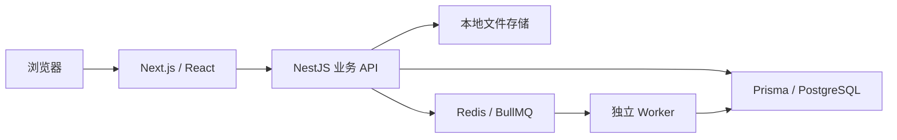

# 架构

个人版采用一个 pnpm workspace，保留 Web、API、数据库访问与独立后台执行的职责分工。

## Web

`apps/web` 提供四主板块及全部子页面、编辑与参考界面。界面通过同源 API 代理访问后端；它不直接连接数据库，也不持有数据库凭据。

共享主题和组件控制视觉；页面组件负责交互状态，业务对象、版本和内容以服务端存储为准。浏览器缓存不能替代持久保存。

## API 与身份

`apps/api` 验证个人登录会话，校验请求，再对当前个人工作空间执行操作。一个本地所有者和一个工作空间足以完成个人版，不附带平台注册、会员或批量用户运营后台。

每次访问内容与文件都应检查身份和归属。不能因为是个人部署，就把写入与下载接口开放为无认证访问。

API 保留数据输入校验、关联一致性、版本冲突和清楚的错误状态。草稿、素材和对标档案的关联属于同一工作空间。

## PostgreSQL 与文件

PostgreSQL 保存资料、稿件、版本、关系与状态；本地目录保存上传文件的二进制内容。迁移是新个人版数据库的结构来源，不导入其他部署的历史数据库。

文件访问由 API 校验归属后提供。上传文件名不是可信路径；磁盘位置、文件标识和显示名称应分开处理。备份同时覆盖数据库与上传目录。

## Worker 与队列

Redis/BullMQ 协调独立后台执行。长期业务状态和结果仍存 PostgreSQL。队列消息不应该成为唯一的内容存储。

个人版默认录入、上传和保存不会隐式触发外部处理。未接入的外部能力明确返回不可用状态，不假造执行器或结果。

## 演示数据

初始化脚本写入明确标记的合成案例，使用和个人内容相同的业务读取、编辑与保存路径。演示数据与个人数据通过显式标记区分；清除演示内容不能按标题猜测或清空全部数据库。

## 扩展

保留正常业务请求与页面入口，外部处理实现由使用者自行开发。扩展后仍须遵循身份、工作空间、任务状态、取消与版本合同，详见 [扩展边界](extending.md)。
